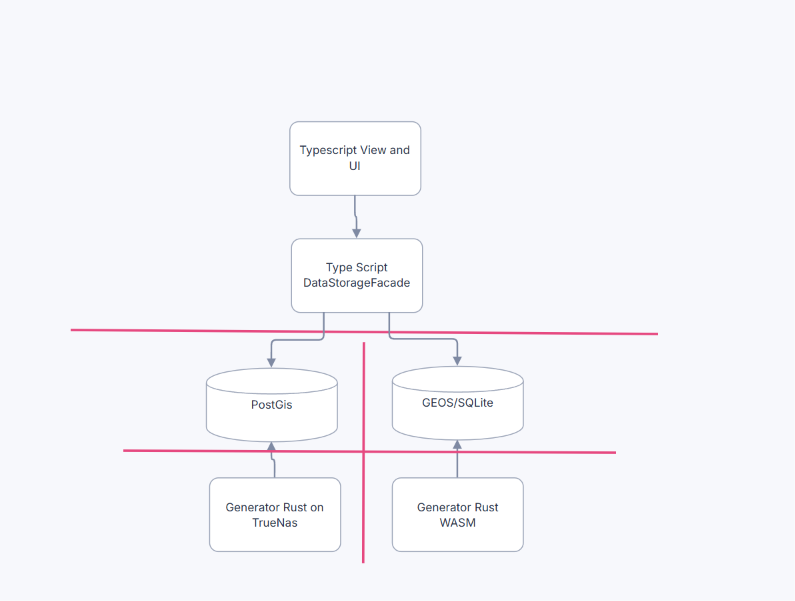
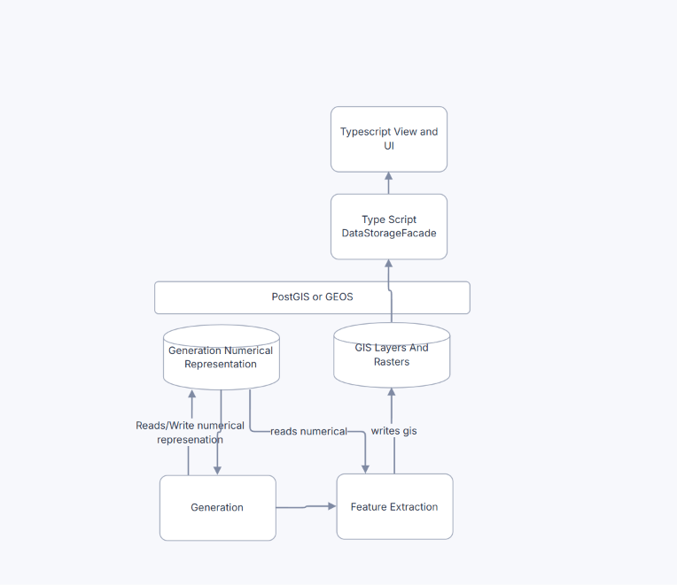

# Finished maps and Rust migration

Working plan, consolidated 2026-11-14. Sulion plan:
`e149a291-9b6b-40c9-9ceb-45ab6e03f700`.

This is the single active plan for the Rust/finished-map migration. Its phases contain
both completed implementation and remaining work. The former migration subplans are
superseded tracking history, not additional execution lists. Other plans, including
regional geography quality and overlay improvements, remain untouched.

The owner authorized migration execution and confirmed the water refactor is complete.
The migration is unfinished. Runtime, GIS separation, frontend adoption, map lifetimes and
representative performance work are complete locally. TrueNAS CI/CD integration and live
deployment remain open. Completed phases below describe
their bounded implementation, not a claim that TrueNAS deployment succeeded.

## Outcome and architectural authority

Creators generate, refine, explicitly save, reopen, inspect, present and export independent
GIS maps through the same frontend in either pure browser or pure backend mode. Both
modes use one shared Rust engine. Normal map use needs no private generation data.

The owner's two diagrams govern the subsystem and data boundaries. Preserve the supplied
images; they are not interchangeable with a language/module dependency sketch.

The durable design is [ADR 0015 — Finished maps and two execution hosts](adr/0015-finished-maps-and-execution-hosts.md).
The diagrams were supplied on 2026-11-14 at 20:56 and 21:12 respectively. The second
makes the feature-extraction stage and separate numerical/GIS stores explicit.

### Required boundaries

These are owner requirements and corrections, not implementation proposals.

- **Numerical generation → extraction → GIS → facade → view.** Generation reads and
  writes private numerical representation. Feature extraction reads it and produces GIS
  layers, rasters, records and attributes. This runs during map production, never on a
  view request. GIS storage is the integration boundary; the viewer does not call
  generation or extraction. GIS spatial queries may use Rust, GEOS or PostGIS. Styling,
  label placement and drawing composition belong to the view.
- **Separate schemas and lifetimes.** Map records and assets can be opened, inspected,
  exported and retained without generation manifests or private-store capabilities.
  PostgreSQL reader privileges exclude the generation schema; local GIS reads open no
  private numerical catalog. Generation can reference a map revision, never the reverse.
  Shared immutable bytes must have independently retained map-owned references.
- **Two pure hosts.** Browser computation and storage stay in the browser. Backend
  computation and storage stay on TrueNAS with its database and files. No hybrid,
  independent storage/compute toggle or automatic fallback. One Rust core serves native
  and one browser WASM target; wasm64 and a second browser build are excluded.
  Backend viewing may cache GIS products without becoming an authoritative local workspace.
- **Rust ownership.** Active TypeScript is UI, view code and local/remote facade only.
  Preparation, generation, naming, extraction/publication and storage services belong in
  Rust. Headless generation uses no browser or JavaScript runtime. Only unavoidable
  browser file/worker/platform bindings remain outside Rust computation.
- **Archive first, without fallbacks.** Whole TypeScript implementation packages and their
  tests remain in an unused archive outside workspace and routine CI discovery. Preserve
  licenses, optional port-check references and deferred authoring. Missing imports expose
  unfinished migration work; do not restore compatibility copies, redirects, stubs or
  wrappers. No new archive-import guard was requested. Remove Rust migration forwarding,
  duplicate service interfaces and redundant internal serialization too.
- **Preserve architecture and behavior.** Retain owner-private material mutation,
  opaque operations, shared questions/responders, feature-owned execution, typed fields,
  one triangular lattice, MapScale and their existing guards. Port actual configured
  physical, water, ecology, seven-system magic, people/craft, naming and regional
  algorithms. Use the completed water refactor and its final couplings. Data layouts may
  change; architecture paradigms and product coverage may not be reduced.
- **Full map behavior.** Keep all three raster views, every supported overlay and its
  controls, rock/people inspection, registry, names and relationships, completed history,
  illustrations/sheets, previews, cancellation, explicit saves, navigation and export.
  Children keep captured context and independent geography; later parent changes cannot
  alter them. Zoom stays on the open map. Resolve whole islands and coastal selections
  through canonical geometry and stable identities.
- **Memory and scale.** Native execution must exploit available memory through allocation,
  residency and direct access, not merely a larger cache. Account for concurrent jobs,
  reconstruction, geometry, publication, PostgreSQL, ZFS and the OS. Browser memory policy
  must not govern native execution. World and regional maps share representation and
  publication rules; normal regions have roughly the default-world cell count at the
  established fixed resolutions. Necessary regional algorithms remain. Neither map type
  nor a tiny numerical cell alone justifies higher-fidelity publication everywhere.
- **Evidence without numerical-accuracy work.** Use existing explicit-input unit/contract
  tests, UI scenarios and representative maps. Include the actual slow refinement and
  normal-sized world/region cases; an unrelated fast world or microbenchmark cannot
  explain the regression. No solver-accuracy campaign, approximation substitute, replay,
  fingerprints, numerical closure checks, substantial new harness or hard CI timing budget.
  Fine workloads require explicit approval.
- **Deployment and exclusions.** Use existing CI/CD and Komodo for LAN-only TrueNAS
  deployment; no manual installation substitute, public route, RDS or ordinary runtime
  AWS dependency. Credential denial must not be bypassed and does not prevent repository
  deployment preparation. No checkpoints/recovery, legacy converters, autosave/sync,
  arbitrary geographic/output caps, saved-data deletion, public hosting, billing or MCP
  expansion. Manual authoring and undo remain deferred and preserved.

## Design and code organization

| Subsystem                      | Code home                                                       | Inputs and outputs                                                                          |
| ------------------------------ | --------------------------------------------------------------- | ------------------------------------------------------------------------------------------- |
| Numerical generation           | Process, field and storage modules in `crates/atlas-generation` | Reads/writes private fields, owner packages and captured context                            |
| Feature extraction/publication | `crates/atlas-generation/src/publication`                       | Reads generated numerical outputs and records; writes independent GIS products              |
| GIS contracts                  | `crates/atlas-map`, generated values in `packages/map`          | Map identities/revisions, coordinates, layers, records, inspection and spatial-query values |
| GIS storage and queries        | `crates/atlas-gis`                                              | SQLite/PostGIS catalogs, map files and spatial operations; no generation dependency         |
| Data-storage facade            | `packages/map` and map operations in `packages/transport`       | Same asynchronous map/library contract over local worker or remote HTTP                     |
| View/UI                        | `frontend/src`                                                  | OpenLayers/React, controls, styles, label placement and composition from GIS data           |
| Application composition        | `crates/atlas-host` and context bindings                        | Wires GIS and generation separately; owns jobs, private inputs and explicit retention       |

A shared native process or WASM artifact does not merge the subsystems. The map reader
must not expose numerical fields, SQL, private paths, generic runtime reflection or a
whole-generation snapshot. Keep job control separate from map reads.

### Map data and delivery

The map owns layer metadata, rasters/vectors, named entities, located geometry, attributes,
relationships, inspection values, completed causes/history, illustration inputs and saved
presentation/navigation. Generation owns recipes, working arrays, material/lattice state,
captured refinement inputs and disposable scratch. Completed history is not execution
recovery or undo.

Publish ordinary GIS assets with explicit bounds, units, nodata, categories, resolution
and useful overviews. The existing tiled GeoTIFF/range-source path and geographic records
are the starting mechanisms. The facade resolves local blob or backend range-readable
sources; the viewer loads relevant map products without fetching hidden layer payloads
just to list their metadata. Derived tiles and style changes read GIS only.

Do not blindly render every numerical channel into its own image or expand the entire
map to its smallest numerical sample. Inventory the actual consumer before grouping
compatible bands or changing product resolution. Retain advanced overlays, categorical
identity, stored inspection values, and all palette/range/logarithmic/opacity/order,
lighting/exaggeration/contour and illustrated appearance controls. Terrain display colors
and class identities serve different consumers. Representation changes must preserve both.

Initial publication can expose visibly incomplete streamed layers and independent epoch
previews. Interrupted initial output cannot be saved as complete. Regeneration validates
and atomically replaces the current revision while the prior complete map stays readable.
A complete map does not require precomputing every theoretical display tile.

### Inspection, regional selection and saving

Point inspection sends map revision, coordinate space, location and scope through
`MapReader`. It returns published values, units/categories, sample footprint/resolution,
feature identities and attributes, rock/people descriptions and completed causes.
It does not decode display colors to infer facts or download numerical generation fields.

Region selection resolves display fragments to stable features and a canonical polygon
or multipolygon, including whole islands, coastal room and compact seam-crossing frames.
The separate `GenerationService` receives that geometry and the pinned parent revision.
The execution host resolves the matching captured private inputs and surrounding context;
it must not silently use newer parent geography.

`MapLibrary` owns explicit saves and expected saved versions. Saving retains the GIS map,
presentation/navigation and separate captured context needed for future refinement.
Stale versions conflict; incomplete output is rejected. Opening a saved map for viewing
does not open the captured inputs. Export reads map data; workspace transfer is outside scope.

Browser reload ends browser jobs and discards unsaved sessions. The existing backend
lifetime design lets jobs survive a client disconnect and exposes status/cancellation
to another client; a service restart does not resume interrupted execution. Completed
unsaved backend results remain session results until explicitly saved. These host-lifetime
mechanisms are implementation choices, not additional recovery requirements.

### Architecture inventory retained by the port

The foundation inventory is retained here without preserving obsolete TypeScript runtime
paths as the target design. Reference implementations and tests live under
`archive/typescript/`; active Rust and existing architecture tests enforce current ownership.

| Contract/data structure                                                                                             | Rust destination and retained behavior                                                                                                           |
| ------------------------------------------------------------------------------------------------------------------- | ------------------------------------------------------------------------------------------------------------------------------------------------ |
| Queues, heaps/TopK, radix ordering, packed lists, sets/stamps, worklists, grouping, union-find, integer-pair lookup | `atlas-generation/src/hpc`; indexed numerical work, reset/requeue and meaningful ordering on explicit inputs                                     |
| Lattice, origin, periodic seams, adjacency, blocks/halos and scale                                                  | `lattice`, `metric`, `scale`, `scale_settings`; one representation and dimensional authority for world and region                                |
| Bands, coverage, read views, snapshots, scratch and pin/release lifetimes                                           | `storage`; immutable inputs and owner lifetimes survive resident/native and paged/browser storage                                                |
| Opaque queries/commands and invocation context                                                                      | `execution`, `bindings`; synchronous queries, dependency/cycle rules, nested context restoration, invalidation after writes/failure/cancellation |
| Feature-owned schedule, registration, epochs and seeds                                                              | `atlas`, `composition`, `sequence`; one executable composition, no parallel schedule or metadata sandbox                                         |
| Questions, base/add/scale/break responders, material modes                                                          | `answers`, `rock`, `magic`, `human`; local extension and distinct seven-system behavior                                                          |
| Settlement, desired/applied contributions and quantity transport                                                    | `settlement`, `transport`; source/destination/pool/facet meaning, availability, retained packages and causal ordering                            |
| Ground, water, people and material owners                                                                           | `field`, `rock`, `water`, `human`; private mutation, retained columns/networks/identities, read-only projections                                 |
| Flow ordering, captured samples and reconstruction                                                                  | `flow_graph`, `reconstruction`, refinement modules; network-specific cycle rules, shared mappings and value-dependent interpolation              |
| Geometry and indices                                                                                                | `atlas-map` spatial contracts and `atlas-gis`; scoped GEOS/PostGIS/R-tree operations, no hand-written global geometry scans                      |

Preserve all twelve original guard families: HPC adoption, canonical fields, process
lifecycle, design/locality, length authority, required geology, regional representation,
regional people, human adoption, human layers, owner directions and water ownership.
Current continuation includes Rust visibility/types, compile-fail contracts and the
existing `rustFoundations.architecture.ts`, `separation.architecture.ts` and
`ownerDirections.architecture.ts`. Phase 15 reconciles their real coverage and caller
adoption; a guard name or source scan alone does not prove behavior. Keep marks, registry
entries and relevant tests together. Do not strengthen agent-derived checks into new
product requirements or weaken owner directions to make a port pass.

The spatial, scale, material and ownership references remain ADRs
[0001](adr/0001-spatial-authority.md), [0005](adr/0005-scale-contract.md),
[0007](adr/0007-magic-systems-are-materials.md),
[0008](adr/0008-regional-refinement-is-conditioned-amplification.md),
[0009](adr/0009-named-entities-persist-and-cells-are-shares.md),
[0010](adr/0010-processes-and-materials-meet-through-modes.md),
[0011](adr/0011-processes-couple-through-keys-and-a-ledger.md),
[0012](adr/0012-people-live-on-the-lands-layers.md) and
[0014](adr/0014-water-is-a-column-and-a-lasting-network.md), subject to current owner
corrections in AGENTS.md. They do not reinstate superseded parent-boundary locking.

## Consolidated phases

The phase numbers below match the single Sulion root. Earlier component and workflow
checks are recorded evidence for those versions, not a fresh verification campaign.
Phases 1–10 are bounded completed implementation; phases 11–18 carry all remaining work.

| Phase | Status      | Outcome                                                |
| ----- | ----------- | ------------------------------------------------------ |
| 1     | Completed   | Architecture and migration contract                    |
| 2     | Completed   | Architecture and data-structure inventory              |
| 3     | Completed   | Backend retirement and TypeScript archive              |
| 4     | Completed   | Rust numerical and execution foundations               |
| 5     | Completed   | Physical, water, magic and ecology ports               |
| 6     | Completed   | People, naming and regional process ports              |
| 7     | Completed   | Direct native and WASM storage services                |
| 8     | Completed   | Resident memory and shared spatial preparation         |
| 9     | Completed   | GIS subsystem and viewer separation                    |
| 10    | Completed   | Local LAN packaging foundation                         |
| 11    | Completed   | Complete Rust runtime and remove migration scaffolding |
| 12    | Completed   | Complete feature extraction and GIS publication        |
| 13    | Completed   | Complete frontend and facade adoption                  |
| 14    | Completed   | Verify saves and independent map lifetimes             |
| 15    | Completed   | Verify full workflows and architecture                 |
| 16    | Completed   | Profile complete workloads and fix measured causes     |
| 17    | Blocked     | Integrate CI/CD and verify LAN deployment              |
| 18    | Blocked     | Finalize migration documentation and close             |

### 1. Architecture and migration contract

Record complete map behavior, separate numerical/GIS data, two pure modes and Rust ownership. Owner diagrams and ADR 0015 govern the design; docs/FINISHED-MAPS-PLAN.md is the single working copy.

Current state: Contract and milestones retained; consolidated to one root on 2026-11-14. Superseded instructions to preserve active TypeScript and renderer-specific Rust services are removed.

### 2. Architecture and data-structure inventory

Inventory existing data structures, owner boundaries, process/query contracts and all twelve architecture guard families. Preserve their intent in Rust; distinguish user requirements from replaceable layouts and agent mechanisms.

Current state: Original inventory read implementation and guard bodies. Current Rust destinations and remaining guard/caller review are retained in this plan; old foundation checks do not prove full migration.

### 3. Backend retirement and TypeScript archive

Retire C# and TypeScript backends and obsolete support paths. Move entire implementation packages and tests to unused archives outside workspace/normal CI; preserve licenses and deferred authoring, accept missing imports without fallbacks or new archive guards.

Current state: Legacy backends retired; remaining domain, browser-storage and engine implementation packages moved whole. The resulting broken consumers are owned by phase 13, not repaired through archive imports.

### 4. Rust numerical and execution foundations

Shared lattice and MapScale, typed bands and ownership, packed numerical structures, opaque queries/commands, responder composition, material settlement and quantity transport. Preserve invocation context, invalidation, snapshot/release and owner-private mutation.

Current state: Foundations implemented with recorded explicit-input native/WASM and architecture checks. Memory and capture improvements are recorded separately in phase 8; final gate adoption remains phase 15.

### 5. Physical, water, magic and ecology ports

Port configured physical families, geology, climate, water/ice/rivers/sediment/coasts, all seven distinct magic systems and meetings, ecology, epoch bindings and physical history from final sources. No reduced algorithms or solver-accuracy campaign.

Current state: Recorded ports include the completed water refactor, restored river-mouth deposition, physical and regional coupling. Earlier native/WASM workflow results predate the latest host correction; complete current-host checks remain phase 15.

### 6. People, naming and regional process ports

Port shared human layers, identities, crafts, places/POIs, maintained lines, roads/sea lanes, built/site/interior generation, naming with licenses and captured regional development. Preserve shared people path, causes and independent children.

Current state: Process implementation and workflow assembly are recorded complete. Regional input resolution, publication and actual current application integration remain phases 11-15; unrelated geography quality outcomes are not declared solved.

### 7. Direct native and WASM storage services

Link GEOS and SQLite directly on native and the single WASM target. Keep PostGIS schemas and map transports independent of private inputs. Remove JS SQL/geometry services, numerical handles and Rust-JS-Rust resource forwarding.

Current state: Direct linkage, filesystem resources, map contracts and OPFS SQLite reopen check pass. Node-supervised generator/raster pipe and computational callbacks removed. Complete job/publication orchestration review remains phase 11.

### 8. Resident memory and shared spatial preparation

Use resident typed backing and borrowed numerical reads with host-wide allocation; partition independent native work without changing causal order. Select capture layout by geography rather than map profile; share donor mappings across channels while retaining value-dependent reconstruction.

Current state: C2/C3 implementation completed: native allocation and parallel TIFF encoding, footprint-based capture layout and reused donor mappings. Publication masks/mappings are partly implemented. Workload-level memory/performance evidence remains phase 16; asset grouping remains phase 12.

### 9. GIS subsystem and viewer separation

Implement both owner diagrams: numerical generation -> feature extraction -> GIS storage -> TypeScript facade -> view. Separate atlas-gis from generation, keep publication in atlas-generation/publication and drawing composition in frontend. No numerical/private access through the map facade.

Current state: Independent atlas-gis extracted; callers updated directly; renderer-specific Drawing RPC removed. ADR 0015 and source organization document boundary. GIS and focused architecture checks, native lint, WASM build and browser persistence pass; frontend integration remains phase 13.

### 10. Local LAN packaging foundation

Provide native/frontend image, Compose and schema/role setup using existing platform mechanisms, with separate map/private capabilities and LAN HTTPS. Retain this completed package work without treating it as deployed.

Current state: Earlier local image/startup and restricted-role checks are recorded. Package must be rebuilt for the corrected runtime and integrated into CI/CD in phase 17; TrueNAS deployment is unverified.

### 11. Complete Rust runtime and remove migration scaffolding

Finish direct create/refine/regenerate, preparation, record/resource ownership, extraction/publication, retention, jobs, previews/progress and cancellation on both hosts. Trace complete callers and delete migration wrappers, duplicate services and internal serialization bridges; preserve real ownership and local/remote facade.

Current state: Complete. Shared generation_execution and direct storage run native and WASM create/refine. The redundant asynchronous publisher adapter and asynchronous filesystem signatures are removed; extraction calls the actual GIS writer. Native execution has no browser runtime. Lifecycle and full-workload validation remain in phases 14–16.

### 12. Complete feature extraction and GIS publication

Inventory every map consumer and publish all needed rasters, vectors, attributes, inspection/history and illustration inputs. Review resolution by consumer, group compatible assets and batch writes. Keep shared world/region rules, progressive initial output, atomic replacement and captured-input binding; viewing never invokes extraction.

Current state: Complete. Compatible overlays share planar TIFF assets by source geography and presentation group, with explicit per-layer band addresses and batched GIS descriptor updates. Display pixels use declared map sample span rather than capture-tree minima. Browser sources resolve immutable OPFS Files without copying complete assets through WASM/CBOR. Current native/browser maps publish; fixture rendering and generated-map views pass. Every existing overlay and inspection value is retained. Performance assessment remains in phase 16.

### 13. Complete frontend and facade adoption

Restore normal application and supplied-map fixtures with only UI/view/generated declarations and local/remote facades. Preserve all three views, overlays and controls, inspection, registry/history, region selection, illustrations/sheets and export. Backend mode must not initialize local generation or silently fall back.

Current state: Complete. Archived imports and configuration declarations are resolved through Rust-generated contracts and frontend-owned presentation metadata. Frontend typecheck, 153 routine unit checks and existing supplied-map UI scenarios pass. Fixtures publish explicit samples through Rust and install GIS-only files. Startup generation metadata is deferred until a generation action; viewing a saved map issues no generation calls. Two backend clients render and inspect a generated map with generation disabled. GIS composition remains frontend-owned.

### 14. Verify saves and independent map lifetimes

Verify current host wiring for explicit saves, library versions, unsaved views/regions, separate captured inputs, reopen/refine and independent children. Stale saves conflict; incomplete maps cannot be saved; parent changes do not alter captured child resources. Check independent backend clients and local-only browser saves.

Current state: Complete. Native save/reopen, parent regeneration, retained child revision/configuration and cancellation pass. Browser explicit save/reload and independent-tab checks pass; supplied and real generated maps reopen after a full browser process restart, including captured generation configuration. Real browser selected-region refinement and regeneration completed. Two native clients render and inspect with generation disabled. An earlier temporary browser profile was found empty for an unverified reason; fresh fixture and real-map restart checks did not reproduce it. No autosave, merge or format migration.

### 15. Verify full workflows and architecture

After phases 11-14, restore ordinary builds and existing lint/unit/UI/architecture/native/WASM gates. Exercise complete current create/refine/regenerate, cancellation, publication, save/reopen and inspection on both hosts, with generation data unavailable during viewing. Reuse supplied maps and representative results.

Current state: Complete. Native workspace tests/clippy, PostGIS publication/save/reader-boundary integration, production WASM build and 49 current architecture checks pass. Chromium, Firefox and WebKit pass the 11 existing UI scenarios; frontend typecheck/build and 153 routine checks pass. Actual native/browser create/refine/regenerate/save/cancel workflows have run. A normal-sized world exposed Delaunay identity lookup based on separately rounded coordinates; input and output now use GEOS-canonical site identities. Spatial contract tests pass. Standalone wasm-bindgen test binaries fail with duplicate closure exports in the Emscripten toolchain. Their sources remain, but this agent-derived runner requirement is replaced by native unit/architecture checks plus existing browser scenarios against the production WASM artifact. No custom test harness, simulation-outcome unit tests, numerical replay or Fine workload without approval.

### 16. Profile complete workloads and fix measured causes

Profile actual saved slow refinement plus normal-sized world/region cases on current Rust hosts. Separate generation, extraction, publication, database, I/O, network and rendering; measure resident memory/spill, CPU and payload volume. Fix demonstrated stage costs in sequence and reassess the whole run.

Current state: Complete. The recorded Draft configuration, using a freshly generated parent, retains all 922 layers. Grouping reduced raster assets from 894 to 36 but did not reduce regional runtime by itself. Resident solver buffers, compact sample serialization, contiguous addressing and direct owner material reads reduced sampled regional CPU from 585 to 358 seconds and wall time from 692 to 496 seconds. Peak recorded-case RSS was about 798 MiB. Concurrent work affects wall-time comparisons. A normal Draft world and region also completed, retaining 949 layers; before the final address/material changes they took 1454 and 572 seconds. Their rectangular lattice has about 15,000 and 26,000 slots, including regional context, versus about 1,000 and 19,000 in the whole-parent stress selection. These results do not reproduce the historical 55-minute saved input or establish that every performance concern is solved. Browser stack overflow is fixed and actual workflows run. No caps, disabled layers, approximation substitutes or hard CI budgets.

### 17. Integrate CI/CD and verify LAN deployment

Integrate existing Ahara image/prebuild, database provisioning and Komodo deployment; rebuild corrected native plus single WASM frontend artifacts. Validate local PostGIS, persistent files, reader roles, scratch/memory and LAN HTTPS. Verify deployment from actual CI logs and two home clients.

Current state: The current local image builds, starts, serves backend-mode HTML and answers its health check. CI declares the native binary artifact, builds production WASM and supplied-map artifacts before the existing three-browser action, and gates the shared pipeline on those browser jobs. Docker consumes the ordinary frontend output; Compose consumes the GHCR image selected by Komodo's IMAGE_TAG. Database registration, the three provisioned role connections, stack activation and home-client verification remain open. The intended credential path previously returned exit 66 / 403 Forbidden with no secret unlocked for this terminal; the owner has not indicated it was fixed, and no retry or alternate credential was attempted. No manual deployment substitute, public route or RDS.

### 18. Finalize migration documentation and close

After phases 11-17 succeed, reconcile product/generation/architecture/usage guidance with actual implementation, preserve owner diagrams and code boundaries, remove obsolete migration references and delete the working plan and its references. Close this root only when migration outcomes are met.

Current state: Runtime, architecture, usage and code-layout guidance is reconciled with the Rust implementation and owner diagrams. Final closure and deletion of this working plan wait for phase 17. Unrelated geography/overlay/authoring plans remain untouched. No separate verification or handoff report.

## Execution order and completion evidence

Continue phases 11–13 together at their real producer/consumer boundaries; do not reopen
the already completed ports merely because the old plan had stale statuses. Phase 14
checks their save/input lifetimes. Phase 15 establishes current full workflows and guard
adoption. Phase 16 profiles the actual slow case and normal maps once those paths work;
local performance work does not wait for deployment. Repository CI/CD preparation in
phase 17 may proceed independently, but deployment verification uses the finished
artifacts. Phase 18 closes only after the required outcomes hold.

At each phase, read its body, these boundaries and the relevant actual source. Check
complete caller paths rather than isolated exported functions. Keep findings in the
owning phase here instead of duplicating a migration subplan. Do not change unrelated
plans as part of this consolidation.

Use existing pure-input tests and supplied-map UI scenarios. Lint touched TypeScript
directories before tests; run applicable native/WASM, type/build and architecture gates.
Exercise rendering only where rendered output is the assertion. Reuse completed map
fixtures, preserve worker-generation declarations and avoid hidden full generations in
routine tests. Workload observations assess maps and stage costs, not solver accuracy.

For phase 16, retain the existing slow-refinement/profile artifacts as the case reference.
Measure generation, extraction, publication, database/storage, network bytes/requests,
rendering, resident memory, spills and CPU separately. Reuse maps for cold open, first
visible map, warm pan/zoom, three-base-view and overlay switching, inspection, illustration,
export and cross-device open. Fix demonstrated causes, then reassess; do not substitute
a faster small case or an isolated timer fix for the reported long refinement.

For phase 17, inspect current Ahara integration and TrueNAS deployment mechanisms before
changing their boundaries. Confirm actual PostGIS availability, LAN origin, roles,
persistent/scratch storage and memory. Read real CI/deployment logs; local packaging or a
push cannot establish deployment. Use the prescribed credential path and report an actual
denial without hunting alternatives. Repository preparation is not blocked by that denial.

Keep verification results in chat and existing ignored artifacts/CI output, not a new
report file. Final closure moves durable mechanisms into the product contract, generation
guide, ADR and usage docs, then deletes this working file and its references.

## Implementation choices and unresolved evidence

These are agent choices or technical uncertainties, not new owner requirements:

- Resident backing, borrowed slices, memory allocation policy, parallel TIFF encoding and
  prepared spatial mappings are selected mechanisms. Evaluate actual workload adoption
  and host working set; no fixed multi-gigabyte allocation is a per-job entitlement.
- Tiled GeoTIFF/overviews, geographic records and compatible band grouping must satisfy
  the real presentation and inspection inventory. Change the encoding if evidence warrants
  it without dropping behavior or inventing a custom format unnecessarily.
- PostGIS and local HTTPS mechanisms must be verified on the intended TrueNAS installation.
  The existing local package and earlier restricted-role tests do not establish that state.
- Current application build and fixture gaps remain open. Earlier completion claims for
  viewer integration and saves are not carried forward as current end-to-end verification.
- Unfinished geography quality, including the separate river outcome, remains outside the
  migration's claimed completion. Preserve those behaviors and requirements during the port;
  do not cancel their plans or expand this consolidation into their redesign.
