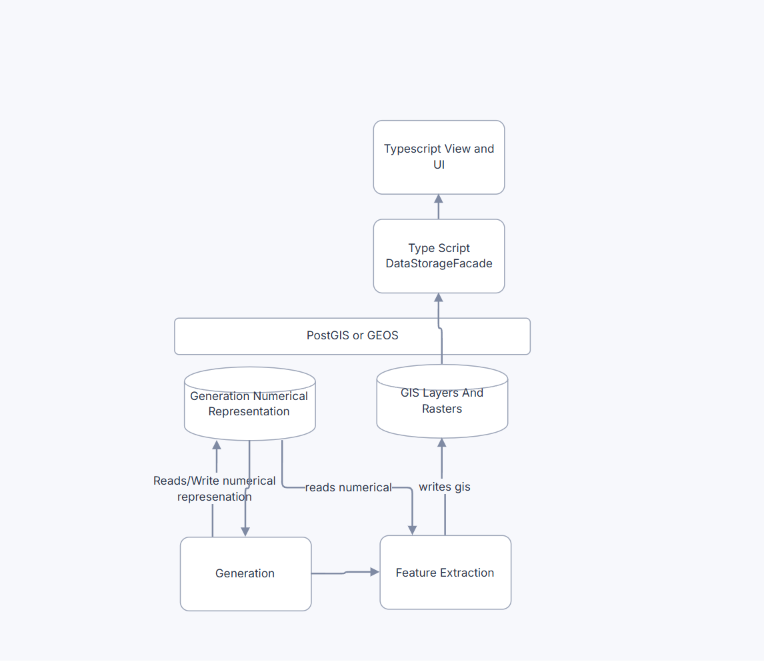

# 0015 — Finished maps and two execution hosts

The owner's 2026-11-12 direction, resumed on 2026-11-13 after the water refactor,
replaces the browser-only restriction and preservation of the old backend prototypes.

The owner's 2026-11-14 subsystem diagram makes GIS storage the integration boundary.
The viewer and generator are independent clients of that storage. A language boundary
is not an architectural boundary: a spatial query in Rust, GEOS or PostGIS is a GIS
operation, not generator execution. Drawing composition belongs to the view.

Generation reads and writes its private numerical representation. Feature extraction
reads that representation and produces the GIS layers, rasters, attributes and inspection
records. This extraction/publication stage runs as part of map production, never on a
view request. The viewer receives the resulting GIS data through PostGIS or GEOS/SQLite
and the TypeScript storage facade. There is no numerical-store route from that facade.

PostGIS on TrueNAS and GEOS/SQLite in the browser are alternative complete deployments,
never a hybrid. Both use this same subsystem layout.
The data facade exposes map records, assets, inspection, spatial queries and map
navigation. It does not expose numerical fields, process state or a renderer-specific
preparation service. The view chooses styles, symbol placement and composition from
GIS results. Publication produces reusable map data rather than instructions to invoke
generation while drawing. Job submission and progress are a separate application
capability; they are not part of map reads.

Code organization follows these components:

| Component               | Implementation home                                    | Data boundary                                                                                        |
| ----------------------- | ------------------------------------------------------ | ---------------------------------------------------------------------------------------------------- |
| View and UI             | `frontend/src`                                         | Map products, presentation state and GIS query results                                               |
| Data-storage facade     | `packages/map`, map operations in `packages/transport` | Same asynchronous data contract for local and remote storage                                         |
| GIS storage and queries | `crates/atlas-gis`                                     | SQLite/PostGIS map records, spatial operations and map assets; no generation dependency              |
| Published map contracts | `crates/atlas-map`                                     | Shared GIS values and publication contract; no generator or host dependency                          |
| Numerical generation    | Process, field and storage modules in `crates/atlas-generation` | Reads and writes private numerical state                                                           |
| Feature extraction and publication | `crates/atlas-generation/src/publication`      | Reads numerical outputs and generated records; produces independent GIS values and assets             |
| Application composition | `crates/atlas-host`                                    | Wires storage and generation separately; owns job lifecycle and explicit retention of private inputs |

`atlas-host` supplies extraction with private inputs and a GIS publisher; it supplies
the viewer with only GIS read/query capabilities. The `publication` module is the
feature-extraction stage in the owner's diagram, not a renderer service or display cache.

Sharing a native process or WASM artifact does not merge these components. A map can
be read, inspected and exported without starting generation or opening its private
inputs. Native headless generation requires no viewer or JavaScript runtime.

A map is a published GIS product. Its schema owns geographic records, named entities,
layer descriptions, raster and vector assets, inspection values, completed history and
illustration geometry. Viewing and export do not reconstruct a generation workspace.
Publication resolves process-specific representation into these map-owned records and
files. Initial delivery remains visibly incomplete when interrupted; replacement maps
become current atomically. Published revisions remain immutable.

Numerical storage holds generation's lattice, material columns, working bands and captured
inputs. GIS storage holds the published map's rasters, vectors, attributes and relationships.
Tiles derive from those GIS products; deleting a tile cache does not require generation
resources to rebuild it. Presentation, inspection and export read GIS storage only.
Surface display colors are published separately from category IDs, so raster interpolation
blends colors without inventing categories. Class identities remain available for inspection.
Compatible overlays share planar GeoTIFF assets while retaining independent layer metadata,
band addresses and appearance controls. Their display grid follows the map's declared
sample span, independent of capture-tree subdivisions. Browser sources use immutable OPFS
Files; backend sources use HTTP ranges. Neither path copies private numerical resources
into the viewer. Stored point attributes refer to the map's band metadata rather than
repeating that metadata in every record.

Private generation inputs belong to a separate schema and file namespace. Refinement
resolves the selected map revision to its captured inputs on the execution host. Children
remain independent maps; parent changes do not alter their captured inputs or geography.
Map readers receive no generation-store handle. PostgreSQL map-reader privileges exclude
the generation schema. The browser map catalog opens independently of generation storage.

There are two contexts: browser computation with browser storage, or backend computation
with backend storage. The frontend uses the same asynchronous map, library and generation
facades in both. A failed backend connection does not initialize a browser generator or
local authoritative workspace. Browser rendering may cache map products.
The static application document selects browser mode. The native service serves the same
frontend artifact with an explicit backend-mode declaration and same-origin facade URLs.

The Rust computation core targets native execution and WebAssembly. Preserve the current
process algorithms, architecture paradigms and ownership guards during the port. Typed
bands, owner-controlled material state, shared questions, opaque operations, scoped reads
and one lattice remain the basis. Per the owner's 2026-11-14 correction, active TypeScript
is limited to UI, view code and local/remote facade bindings. Rust owns preparation,
naming, execution, map production, storage services and the backend application.
Preserve the TypeScript generator and its tests in an unused archive for optional quality
checks; neither production imports nor normal CI use it. Archive source is a reference,
not a fallback or an interface the Rust implementation must reproduce.

Queries receive typed invocation context through the same dispatcher as commands.
Derived values are scoped to both current owner state and current context. Nested
invocations restore their caller's context when they finish or are cancelled; queries
remain synchronous and cannot dispatch material commands.

The retained architecture has these implementation homes:

| Boundary                                                | Rust implementation                                                                                                                                                      |
| ------------------------------------------------------- | ------------------------------------------------------------------------------------------------------------------------------------------------------------------------ |
| Packed queues, heaps, membership, grouping and ordering | `atlas-generation/src/hpc` provides typed work structures; `storage` provides paged bands and read-only views over host scratch.                                         |
| Reading, deciding and writing                           | `execution` owns opaque queries and commands; `answers` composes base, additive, scaling and breaking responders. `atlas/physical` assembles selected operations.        |
| Material ownership                                      | `rock`, `water` and `human` keep their mutation inside their owners. Processes use the registered operations and shared questions.                                       |
| One physical representation                             | `field`, `lattice`, `reconstruction` and `scale_settings` serve both world and regional generation; refinement does not introduce a second field model.                  |
| Finished-map ownership                                  | `atlas-map` defines GIS contracts independently of generation. `atlas-generation/publication` produces them; `atlas-gis` owns SQLite/PostGIS, GIS queries and map files. |

Rust visibility and compile-fail checks enforce owner and invocation capabilities.
The active `rustFoundations.architecture.ts`, `separation.architecture.ts` and
`ownerDirections.architecture.ts` guards cover source adoption, dependency direction
and owner marks. `make test-architecture` runs these with Rust documentation checks.
Archived TypeScript tests remain optional reference material rather than a normal CI path.

Backend development uses TrueNAS compute, its PostgreSQL/PostGIS database and local files.
Per the owner's 2026-11-15 correction, a custom database image in this application's
Compose stack supplies PostGIS while the TrueNAS catalog PostgreSQL app remains separate.
No public route or RDS dependency is part of this installation. The old C# and TypeScript
backends, historical migrations and deployment scripts are removed, not adapted.

Manual authoring and undo remain deferred and preserved. This decision adds no execution
checkpoints, restart/recovery, format conversion, numerical replay checks or output caps.
