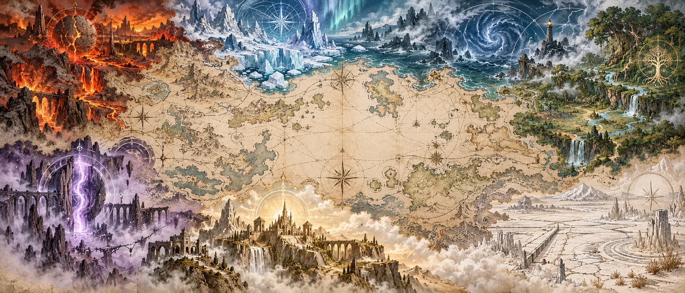
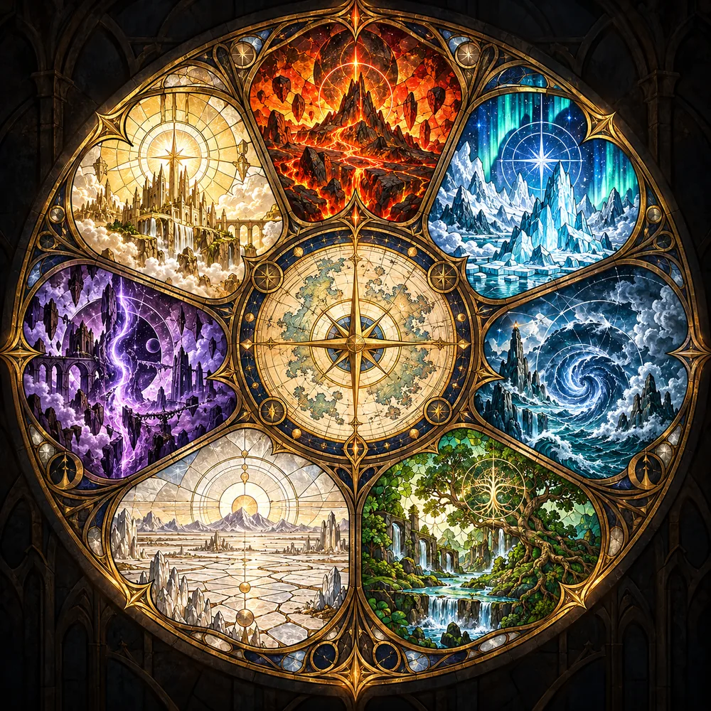

# Magic lore bible



This guide describes the seven magic systems in
[magic system candidates](../magic-system-candidates.md). Each entry covers a system's physical
nature, where it occurs, its effects on the landscape, and how people use it. The lore sections
offer beliefs and customs that a world author can adapt without adopting a particular setting.
Peoples, gods, places and events are left to the author. "Practitioner" means anyone who works with
a system, regardless of species.

Fire, Aurora and Pressure are implemented as described in the
[product contract](../product-spec.md#103-magical-generation--fire-aurora-and-pressure). Their
proposed extensions and the four new systems remain designs.

## The seven

| System                          | Medium                           | Epigraph                                                            |
| ------------------------------- | -------------------------------- | ------------------------------------------------------------------- |
| [Fire](magic/fire.md)           | stone, including fallen cores    | _The hearth that can be carried._                                   |
| [Aurora](magic/aurora.md)       | ice                              | _The light withdrew. Its sparks remain in the ice._                 |
| [Pressure](magic/pressure.md)   | deep water                       | _The river that had to be caught before it could reach the ground._ |
| [Greenwood](magic/greenwood.md) | sap and groundwater              | _The seed is the same everywhere. The ground decides._              |
| [Salt](magic/salt.md)           | brine                            | _A garden in the bed of a vanished lake._                           |
| [Veil](magic/veil.md)           | tears where other systems meet   | _A door needs a house, and a house needs a keeper._                 |
| [Hallowed](magic/hallowed.md)   | maintained routes and boundaries | _The ground on which nothing is harmed._                            |



## The shape of the seven

Each system acts through its own medium. Fire stores heat in stone; Aurora holds charge in ice;
Pressure travels through deep water and drives weather above it. Greenwood moves through sap and
groundwater, Salt through brine. Veil occupies tears formed where other systems clash. Hallowed
follows the routes and boundaries that people maintain. None serves as fuel for another. Where
systems meet, their interference changes the landscape: cracked ground along a thermal rim, steam
fractures, a line of dying trees or a tear in space.

Each practice also has a cost. Fire burns its users. Aurora readers lose track of which memories are
their own. Pressure users become slow to respond and feel partly absent, as though still in the
deep. Greenwood binds practitioners to the land they tend; Salt leaves them unable to forget. Veil
crossings blur their sense of where they are. Hallowed vows restrict travel and require lifelong
maintenance of the boundaries they protect.

## How the seven touch

| Meeting              | What the map shows                                      |
| -------------------- | ------------------------------------------------------- |
| Fire / Aurora        | rim of cracked ground, Veil where fields change sharply |
| Fire / Pressure      | steam fractures and a broken coast                      |
| Fire / Greenwood     | rot halo, steam fractures at springs                    |
| Fire / Salt          | burnt-clean ground, the one way to end a Barrow heath   |
| Aurora / Pressure    | breached coast, Veil where fields change sharply        |
| Aurora / Greenwood   | frozen forest front                                     |
| Aurora / Salt        | undeath: preserved dead on the Barrow heath             |
| Pressure / Greenwood | salted coastal springs                                  |
| Greenwood / Salt     | dying trees, Veil where fields change sharply           |
| Hallowed / any       | weaker effects inside, concentrated effects at the rim  |
| Veil / any           | closed by Aurora, ruptured by Fire, sealed by Hallowed  |

## Adjacent sources

Each lore section draws on a real-world tradition or practice chosen to suggest customs and beliefs
beyond familiar fantasy conventions. The sources were drawn at random from the pool in
[`lore-pool/pool.txt`](../lore-pool/pool.txt), 385 texts, practices and concepts in 53 tradition
families, with [`lore-pool/roll.py`](../lore-pool/roll.py). The script rolled three draws (seeds
338923 to 338925), each giving three candidates per system with no two systems sharing a family, and
one candidate per system was chosen from across the draws. To reroll:

```
python3 docs/lore-pool/roll.py docs/lore-pool/pool.txt --rolls 3
python3 docs/lore-pool/roll.py docs/lore-pool/pool.txt --seed 338923 --rolls 3
```

The second command reproduces the recorded draw. These sources inspired the entries' teachings; they
do not establish religions or history for a generated world.

| System    | Adjacent source                                                                                                                                                                                                                                                                                                                                                                        |
| --------- | -------------------------------------------------------------------------------------------------------------------------------------------------------------------------------------------------------------------------------------------------------------------------------------------------------------------------------------------------------------------------------------- |
| Fire      | Slavic household religion: the domovoi carried with the live coals to a new house and greeted with bread and salt; Koschei's death nested inside needle, egg and duck ([Domovoy](https://en.wikipedia.org/wiki/Domovoy), [folk account](https://godsandmonsters.info/domovoi/))                                                                                                        |
| Aurora    | Lurianic Kabbalah: tzimtzum, the withdrawal that leaves room for a world; the breaking of the vessels; tikkun as the gathering of sparks, whose completion would end the world as known ([My Jewish Learning](https://www.myjewishlearning.com/article/tikkun-in-lurianic-kabbalah/))                                                                                                  |
| Pressure  | Ganga's descent: a river too strong to land unbroken, caught in Shiva's matted hair, wandering there for ages, released in seven streams; the sage who swallowed her and let her out through his ears ([Bhagiratha](https://en.wikipedia.org/wiki/Bhagiratha), [Valmiki Ramayana](https://www.wisdomlib.org/hinduism/book/the-ramayana-of-valmiki/d/doc423893.html))                   |
| Greenwood | The parable of the sower: one seed on four soils, path, stone, thorns and depth, with the outcome decided by the ground and the teaching framed by the command to listen ([commentary](https://thebiblesays.com/en/commentary/mrk+4:1), [kjvstudy](https://kjvstudy.org/parables/the-sower))                                                                                           |
| Salt      | Karesansui dry landscape gardens: raked gravel standing for absent water, stones set as islands, raked daily, and a layout in which one stone is always hidden from any viewpoint ([Japan Journal](https://www.japanjournal.jp/society/culture/pt20211009394.html), [overview](https://wikipedia.classicistranieri.com/en/articles/j/a/p/Japanese_rock_garden.html))                   |
| Veil      | The Vodou poteau-mitan: the centre post of the peristyle, sometimes a living tree, the axis by which spirits descend to inhabit the faithful for a time, around which the whole rite turns, with the gatekeeper saluted first ([Potomitan](https://en.wikipedia.org/wiki/Potomitan), [glossary](https://www.historymuseum.ca/vodou/wp-content/themes/vodou/images/Vodou_glossary.pdf)) |
| Hallowed  | Jain ahimsa toward one-sensed beings: earth, water, fire, air and plants as living and harmable; mendicants who do not dig, kindle, fan or swim and cover the mouth to protect air-bodies; householders who minimise rather than eliminate harm ([jainqq](https://jainqq.org/explore/000161/50), [herenow4u](https://herenow4u.net/?id=91641))                                         |
