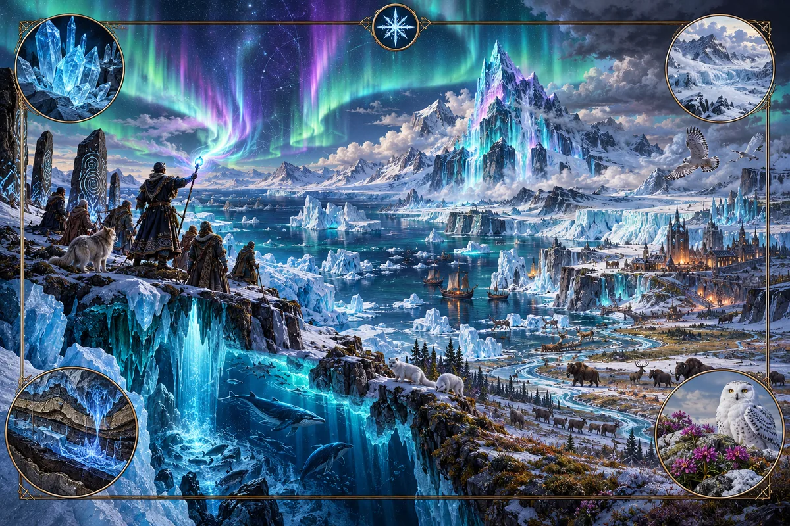

# Aurora

_The light withdrew. Its sparks remain in the ice._

**Physical character.** Aurora is a charge that falls from the sky toward cold ground and
accumulates in ice. Thick ice retains it; thin ice and warm ground allow it to drain toward colder
areas. It preserves rather than destroys. Ice that holds it resists melting and surface loss, nearby
ground cools by a few degrees, and growth, decay and ripening slow within the field. Aurora-crystals
concentrate the charge into a portable form. Practitioners work through these crystals.

**Where it is found.** On cold high ground, on ice caps and glaciers, and in the cold drainage
routes that lead toward them. The field is strongest where ice is thickest and oldest. Some charge
remains in the ground after the ice retreats, leaving formerly glaciated valleys cold long after the
glaciers are gone.

**Effects on the world.** Over long periods, Aurora weakens the rock exposed to it. It preserves ice
in climates where that ice would otherwise melt. Its biomes are the Rime forest, where trees grow
for centuries, and the Glow-lichen barrens, where growth and decay are both extremely slow. When the
field retreats, preserved material thaws and rapidly decays. This leaves a fertile strip along the
melt line that attracts settlement.

**Practice.** Aurora requires time and sustained attention. A practitioner attunes to a crystal and
uses its charge to read the past preserved in ice or see a distant place as it is now. The most
skilled can capture a moment in an ice construct that replays it. These are acts of perception; they
cannot harm someone at a distance. Occasional use has little cost, but sustained reading can
permanently damage the reader's sense of self. Memories encountered through the crystal become
difficult to distinguish from personal experience. The oldest readers may rely on familiar routines
because they no longer know which memories are their own. Schools enforce rotations of practice and
rest, and retire readers at the first visible signs of this confusion.

**Lore.** Aurora traditions say that light once filled everything, leaving no room for anything
else. It drew back, and the world grew in the space it left. Believers see the cold around Aurora
ground as a smaller version of that withdrawal: warmth recedes, making room for slower forms of
life. They point to the long-lived trees of the Rime forest as evidence that cold can shelter life
as well as threaten it.

In the next part of the story, light returned too strongly for the vessels made to hold it. They
shattered, scattering shards and sparks into the ice. An Aurora-crystal is said to be one of those
shards, still holding a spark. Readers call themselves gatherers: each reading returns a spark to
its original place. Their warning about a reader who takes in too much light is simple. The first
vessels broke, and so can you.

The traditions teach that when every spark has been gathered, the light will fill the space again
and the world as it is known will end. The melt line, where sparks are released from the ice, is
therefore both a place of work and a reminder of that ending. No reader expects to witness it. The
strictest schools still regard overuse as a way of hastening it, and prescribe rest to protect the
world as well as the reader.

> They told me to keep one memory that was mine alone. I chose the kitchen, my mother's yellow coat,
> the spoon she tapped against the pot.
>
> Today I saw that kitchen in a glacier older than our town. Someone was sitting in my chair.
>
> I put the crystal away before they turned around.

_An unsigned page in a reader's notebook._

**Interference.** Aurora cancels Fire along a thermal rim. Aurora-crystals dissipate a
practitioner's stored Pressure charge. Aurora freezes Greenwood along their shared boundary. Over
Salt ground, its preservation produces undeath: bodies preserved by Salt cannot decay, and the dead
do not rest. Aurora reinforces a Hallowed ward and closes a Veil door.

---

[Magic lore bible](../magic.md) · [Fire](fire.md) · [Pressure](pressure.md) ·
[Greenwood](greenwood.md) · [Salt](salt.md) · [Veil](veil.md) · [Hallowed](hallowed.md)
