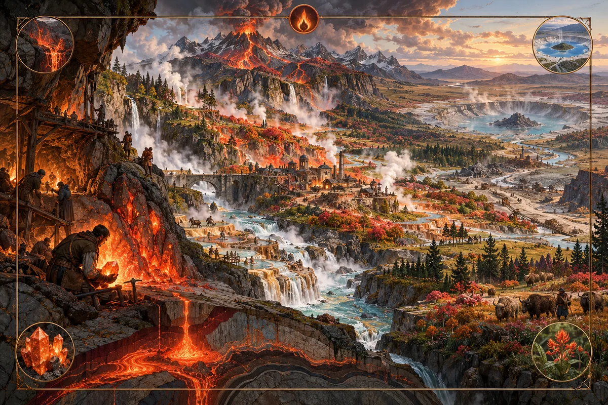

# Fire

_The hearth that can be carried._

**Physical character.** Fire is stored energy in mineral form. A fire-core is a
dense stone that holds a charge of heat compressed into it by the body of the
world, and releases it when cracked. Cores form in two ways. A vein core grows
where geothermal heat rises through a fracture network under land; the fracture
is its conduit, and while the conduit is open the vein makes more cores and the
land above it stays warm. A fallen core arrives from outside in an impact; it is
a finite stock scattered as ejecta around a crater and carried downstream by
rivers as fragments in gravel. Fallen cores carry a metal the world did not
make, and a compass misreads near a field of them.

**Where it is found.** Vein Fire is found at geothermal maxima under land, never
under the sea floor, where the same heat shows as vents and belongs to no
system. Its halos follow the fractures, so a Fire country is a branching one.
Fallen Fire is found at craters, in the fan downwind of them and in river
gravels below them, which is where its placer miners work.

**Effects on the world.** Fire heats the ground, melts ice and hardens the rock
it passes through. It quickens living things: growth, turnover, seeding and
decay all run faster around a core, and the warmth travels down the rivers
below it. Its biomes are the Ember grove at the core and the Thaw meadow on the
melt line. A vein opens its conduits as it flows until it has carried its
budget, then seals, and a sealed vein is a cold hollow with a dead town on it.
A crater field is the opposite shape: a lake in a ring, an ejecta fan that
grows nothing for a long time, and placer bands that make a river rich for a
stretch.

**Practice.** Fire practice is hearth-keeping. A core is a hearth in a stone,
and the practitioner's first skill is banking it: opening it so slowly that it
warms a house for a season, or a forge for a day, without going out. The second
skill is the opposite, cracking it at once so that it cuts stone, collapses a
tunnel or unmakes a wall. Both are done by hand, with the core held and struck
and the release taken through the body, and every use burns. A practitioner's
hands are a record: casual use reddens them, a career leaves them mottled and
stiff, the joints locked, the skin unable to close its own cracks. Practitioners
read burns the way others read ledgers. A clean burn is a clean release.

**Lore.** Fire traditions hold that a house is wherever its coals are. When a
people moves, it does not leave its fire behind. The live coals are raked from
the old hearth into a covered pot and carried, and the hearth's keeper is
understood to ride the coals to the new place, where it is greeted with bread
and salt. To abandon a hearth with its fire still in it is the worst luck a
Fire people knows, and a sealed vein is read as exactly that: a house whose
coals no one carried, now cold, with the keeper still in it. A Fire town that
hears its vein is nearing its budget begins choosing which cores to carry.

The traditions also teach that a core's heat is hidden the way a death is
hidden: inside the stone, inside the vein, inside the mountain, each inside the
next, so that whoever would reach it must open every layer. This is why cores
are cracked and not burned. The heat is not on the surface of the stone; it is
nested at the centre, and the venting pick finds the one place where the
nesting can be undone. Fallen cores trouble this teaching. They are coals from a
hearth that burned somewhere else and arrived without a keeper. Some schools
refuse them as strangers' fire. Others carry them as one would carry a
foundling, and a smith who works their metal is known by the colour of the
blade.

**Interference.** Fire and Aurora cancel where they meet, and the line of
cancellation is a thermal rim of cracked ground. Fire released near carried
Pressure is destructive to both. Fire boils Greenwood's springs into steam
fractures and overdrives its growth into rot. Fire burns Salt ground clean.
Fire conduit opening breaks a Hallowed ward line. Fire release ruptures a Veil
door.

---

[Magic lore bible](../magic.md) · [Aurora](aurora.md) · [Pressure](pressure.md) · [Greenwood](greenwood.md) · [Salt](salt.md) · [Veil](veil.md) · [Hallowed](hallowed.md)
