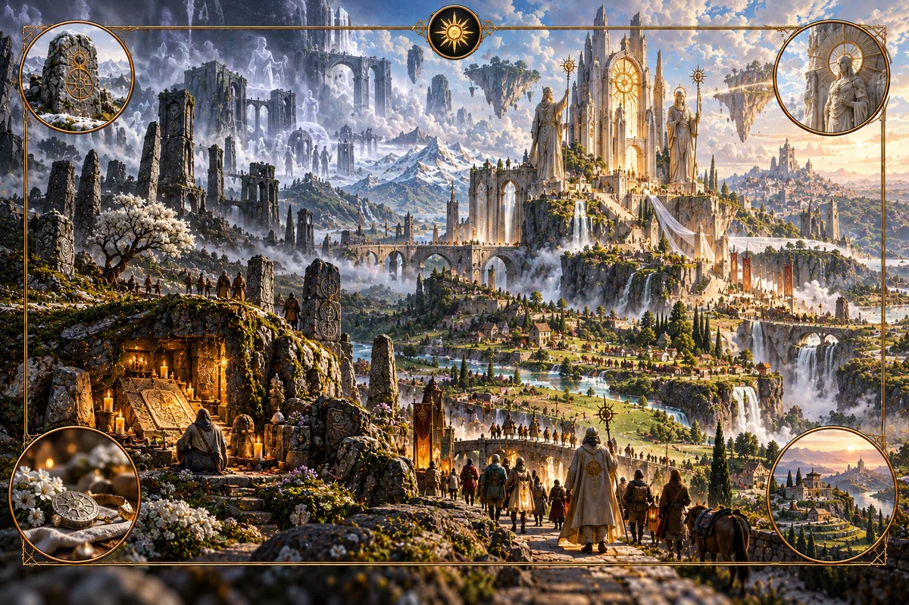

# Hallowed

_The ground on which nothing is harmed._

**Physical character.** Hallowed is the one system made by people. It
accumulates where they gather over long time, strongest at seats held for many
generations and at the destinations of pilgrimage, and it holds along a line
that people bind: a wall, a border, a river bank. It travels along the routes
that people keep walking and is stored at shrines, in crystal and in set stone.
It decays when the shrine is abandoned or the line is no longer walked. Inside
it the other systems are damped: a Fire halo cools, Salt halts at the
boundary, a Veil door seals, a storm track turns. Along a bound line, geography
stops moving: the river keeps its bed, the coast stops eroding, and a border
becomes a physical discontinuity that can be seen from the air. Whatever
Hallowed damps accumulates at its rim.

**Where it is found.** At old seats and sanctuaries, along pilgrimage roads,
along maintained walls and borders, and in the ruins of all of these, which hold
a fading halo for a long time after the keeping stopped. A Hallowed map is a map
of where people have been restrained.

**Effects on the world.** Hallowed ground is calm ground. Rivers inside it are
stable, coasts inside it hold, the magic of other systems is muted, and crops
and people are safe from the hazards that surround them. The rim is the
opposite: whatever Hallowed held back is piled there, and the country just
outside a great sanctuary is often the most dangerous in the region. There are
no Hallowed biomes. Its signature is that the biomes inside it stay what they
were.

**Practice.** Hallowed practice is restraint. Inside the bound, the earth is
not dug, fire is neither kindled nor put out, water is not dammed or drawn
beyond need, the air is not stirred, and what grows is not cut. The vow has two
grades. Specialists keep it whole: they go on foot, sweep the path before them,
cover the mouth when they speak, and own nothing that would need the ground
opened. Everyone else keeps it in part, minimising what cannot be avoided, and
the traditions are explicit that a household cannot keep the whole vow and
should not pretend to. Consecration is the vow made over a place; a ward line
is the vow made over a boundary; the set stone marks where the vow begins. The
cost is the freedom to leave. A specialist who keeps the whole vow cannot
ride, dig, kindle or carry, and so cannot travel except slowly and on foot
along kept routes, and a people that has bound its border must walk it forever
or watch it fail.

**Lore.** Hallowed traditions begin by counting what is alive. Earth is alive,
water is alive, fire is alive, air is alive, and every plant, each with one
sense, the sense of touch, and each able to be harmed. From this follows
everything. The other six systems are, in Hallowed teaching, harms: Fire burns
the earth-bodies, Pressure crushes the water-bodies, Salt kills the
plant-bodies, Aurora stills them, Greenwood crowds them, Veil tears the ground
itself. Hallowed is simply the ground on which these harms are not done, and
the damping is not a power but a consequence. Where no one digs, Fire has no
conduit opened for it; where no one dams, Pressure's storm has no stilled water
to feed on; where no one cuts, Salt has nothing dying to take. The sanctuary is
calm because within it nothing is hurt.

The rim follows from the two grades of vow. A household that keeps the vow in
part does its unavoidable harm somewhere, and that somewhere is just outside
the bound. The traditions do not hide this. They teach that every sanctuary has
a shadow of displaced harm around it, that the shadow is the price of the calm,
and that a Hallowed people owes its neighbours for what it exports. The
landmark stone is the gravest matter in their law for the same reason. To move
a boundary is to dig the earth, which is harm; it is also to move the line
where restraint ends and displaced harm begins, onto someone who did not agree
to it. A people that moves a stone has broken the vow twice, and the Hallowed
that was held by the stone goes out of the ground.

**Interference.** Hallowed is the interference system. Fire conduit opening
breaks a ward line. Aurora reinforces one. A Hallowed rim turns a Pressure storm
track and halts a Salt front; a Hallowed ward seals a Veil door. Its own cost
is its rim.

---

[Magic lore bible](../magic.md) · [Fire](fire.md) · [Aurora](aurora.md) · [Pressure](pressure.md) · [Greenwood](greenwood.md) · [Salt](salt.md) · [Veil](veil.md)
