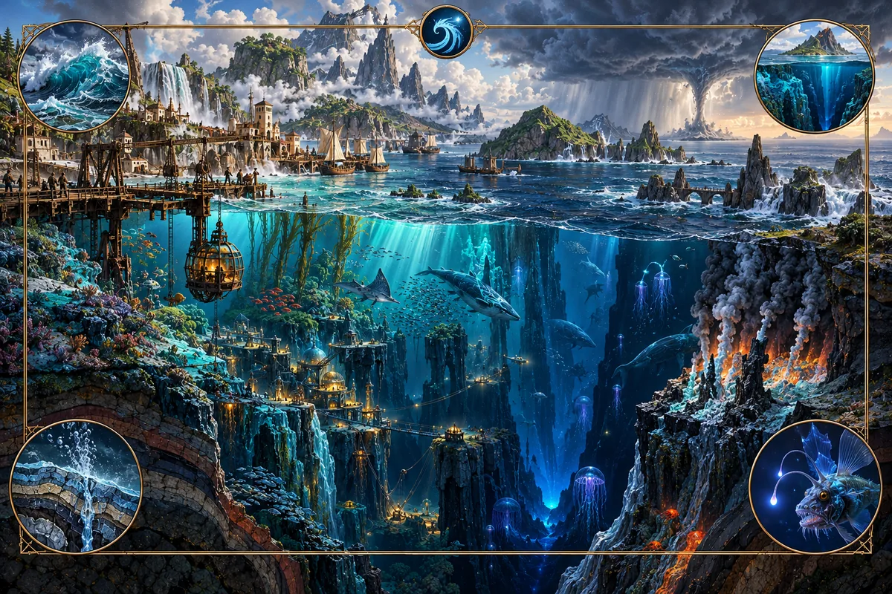

# Pressure

_The river that had to be caught before it could reach the ground._

**Physical character.** Pressure originates at a source in the deep ocean and travels outward
through water along paths called rays. These reflect from coasts and shelves, and can reinforce one
another where they cross. As rays reach shallower water, they drive cold water upward, cooling the
surface and bringing fog to the facing coast. A strong front leaves warm, still water behind it: a
wake. Where many rays converge, repeated crushing forces grind the seabed and shore. Past wakes and
sudden impacts leave lasting marks on the coast. Strong fronts change coastal climate. A warm wake
beneath cold air can raise a storm that carries their effects inland.

**Where it is found.** Pressure travels through the deep ocean to coasts, shelves, straits and the
sheltered sides of islands. Its weather effects reach inland along storm tracks. A coast's exposure
depends on its angle to the source and the shelves, islands and other obstacles between them.

**Effects on the world.** Pressure reshapes coasts through repeated stress. Upwelling cools the sea
surface and feeds fisheries, while fog supports Fog heath and Moss forest along exposed shores.
Wakes leave warmer water behind the fronts. Storms bring rain and snow to windward slopes, scour
soil and move dunes. They leave the sheltered side of a mountain range dry. A wet range with a
desert behind it can be as characteristic of Pressure as a fogbound coast.

**Practice.** Practitioners gather a charge by descending into deep water. Greater depth offers more
force, provided the diver can withstand it. Below a sufficient depth, they can direct that force and
bring a charge to the surface. It allows them to communicate over long distances through vibrations
too low to hear, exert force without contact and, in the oldest practice, commune with whatever
answers from the deep. The physical ability to survive the descent limits who can practise. On land,
sky-readers study the resulting weather, learning which wakes will raise storms and where those
storms will travel.

Carrying a charge leaves practitioners feeling distant from their surroundings. The effect lingers
while the charge remains in them. Those who have carried a great deal become slow to respond,
pausing before they answer and feeling as though part of them is still in the deep.

**Lore.** Pressure traditions tell of someone who owed rites to ancestors whose resting place could
not be reached. They asked the deep to descend to that place. It agreed, but warned that its fall
would shatter the ground. A receiver caught it and divided its force into streams before letting it
flow onward.

The story teaches that a force this great must be broken into smaller parts before it can be safely
received. Shelves, reefs and islands serve that role along a coast, splitting incoming rays. Fog,
fisheries and warm wakes show where the divided force has passed. A coast with nothing to break the
force takes the full impact and becomes a crush zone. Sky-readers describe storms as streams still
travelling inland toward the ancestors they were meant to reach.

Practitioners understand their own cost through the same story. The deep waited in its receiver for
ages before being released; a charge likewise lingers in its carrier until used for speech or force.
Each descent leaves more of the practitioner feeling caught there with it. Another tale tells of
someone who swallowed a flooding river in anger, then had to release it through his ears. Teachers
use it as a warning: taking in more than you can release does not give you control over how it comes
out.

> We hauled the diver up at noon. At supper she asked whether the rope had broken. We showed her the
> bell on deck and the rope, still whole. She felt along it twice.
>
> "Then who's still pulling?"

_A ship's log, last entry before the crew cut the bell loose._

**Interference.** A practitioner's stored Pressure charge dissipates near Aurora-crystals and
destroys a Fire charge on contact, consuming both. Where Pressure and Aurora meet along a coast,
their combined effects can breach it. Fire heat columns feed Pressure storms; Aurora's lingering
cold can pin a front in place; a Hallowed boundary redirects a storm track. Pressure upwelling salts
coastal Greenwood springs. A stored Pressure charge cannot pass through a Veil door.

---

[Magic lore bible](../magic.md) · [Fire](fire.md) · [Aurora](aurora.md) · [Greenwood](greenwood.md)
· [Salt](salt.md) · [Veil](veil.md) · [Hallowed](hallowed.md)
