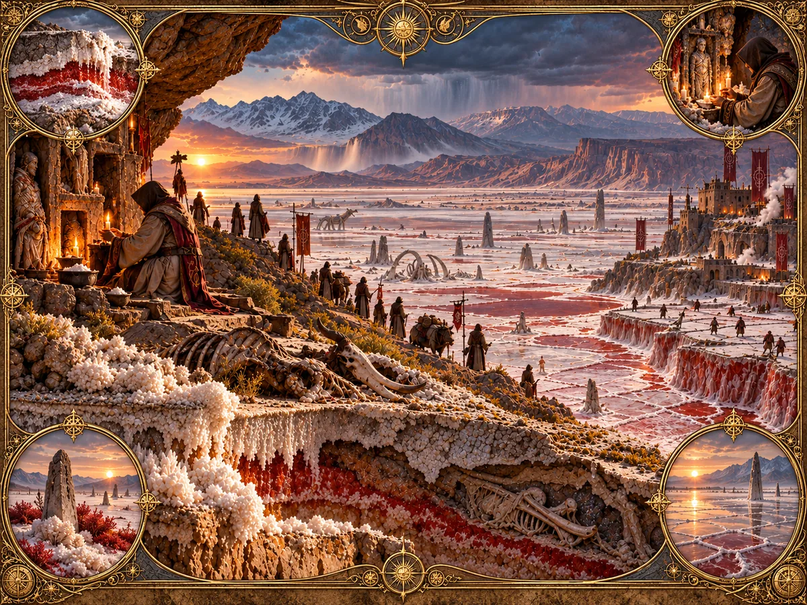

# Salt

_A garden in the bed of a vanished lake._

**Physical character.** Salt is a preserving residue carried in brine. It forms where many lives
ended or where a lake dried in a closed basin, and resists change in whatever it touches. It seeps
downslope with groundwater and persists in dry ground or ground without oxygen. In basins it forms a
crust that wind can carry onward as dust. Its sources are sites of mass death, such as battlefields,
sieges and famines, and dried lake beds in basins with no outlet.

**Where it is found.** On old battlefields and the ground downstream of them, around dead lakes, in
the dry interiors of continents, in the salt pans of the rain shadow. Much of it accumulates through
a world's history, so older worlds generally have more Salt ground than younger ones.

**Effects on the world.** Vegetation thins on Salt ground, grazers avoid it and the soil becomes
infertile. Drying spreads outward from each basin, while the central flats turn to glass. Its biomes
are the Barrow heath on old killing grounds, the Salt pan and the Glass flat. Salt also produces
mirages. Objects on a glass flat can be seen from far away, along with images of people and things
that are no longer there.

**Practice.** Salt practitioners tend pans and burial grounds. They smooth the crust, rake lines
across it, place memorial stones and maintain barrows. Wind and seepage undo the work, so it must be
repeated daily; that repetition is part of the practice. A maintained pan lets a practitioner read
the past held in the ground, lay the dead to rest, bind unbreakable oaths and preserve things
against decay. The most powerful can raise the dead. Traditions that permit this regard it as
incurring a debt that must eventually be paid.

The cost is the ability to forget. Grief stays fresh, oaths remain binding, and faces seen in the
salt never fade from memory. An old practitioner may remember clearly while being unable to set any
of those memories aside.

**Lore.** Salt traditions treat a pan as a garden planted in memory of a vanished lake. Raked lines
represent ripples; stones stand for islands. The arrangement helps a visitor imagine the water and
the lives it once held. Tending a dead lake is a way of remembering what belonged there, and daily
raking keeps that memory visible.

Every raker learns one rule first: wherever you stand, one stone must be hidden. No viewpoint should
reveal all the memorials at once. Followers believe the same rule holds on untended Salt ground:
some part of its history will always be out of sight. They interpret mirages as glimpses of the
hidden stone, and the pillars on some flats as people who went looking for it.

The hidden stone also shapes their law. An oath binds you to those you cannot see, including the
dead. Courts and graveyards belong to the same institution because both protect the claims of the
absent. Salting a destroyed city is believed to make its loss permanent; the Barrow heath downstream
of an ancient siege becomes its memorial garden.

> The witness identified the knife, the hand that held it and the words spoken afterward. Asked
> whether he bore the accused any ill will, he said he was willing to wait.

_Court record. The witness had been buried for eighty years._

**Interference.** Aurora over Salt ground produces undeath: bodies preserved by Salt cannot decay,
and the dead do not rest. Fire burns Salt ground clean, so Fire-using communities burn battlefields
to remove it. Greenwood and Salt compete along their shared boundary. Hallowed stops Salt at its
boundary, and brine pools before the line. Pressure makes Salt coasts: a lagoon closed behind a
still Pressure shore dries to a sabkha, which is a dead lake and so a pan, and the storms the
same sea raises lift its dust inland.

---

[Magic lore bible](../magic.md) · [Fire](fire.md) · [Aurora](aurora.md) · [Pressure](pressure.md) ·
[Greenwood](greenwood.md) · [Veil](veil.md) · [Hallowed](hallowed.md)
