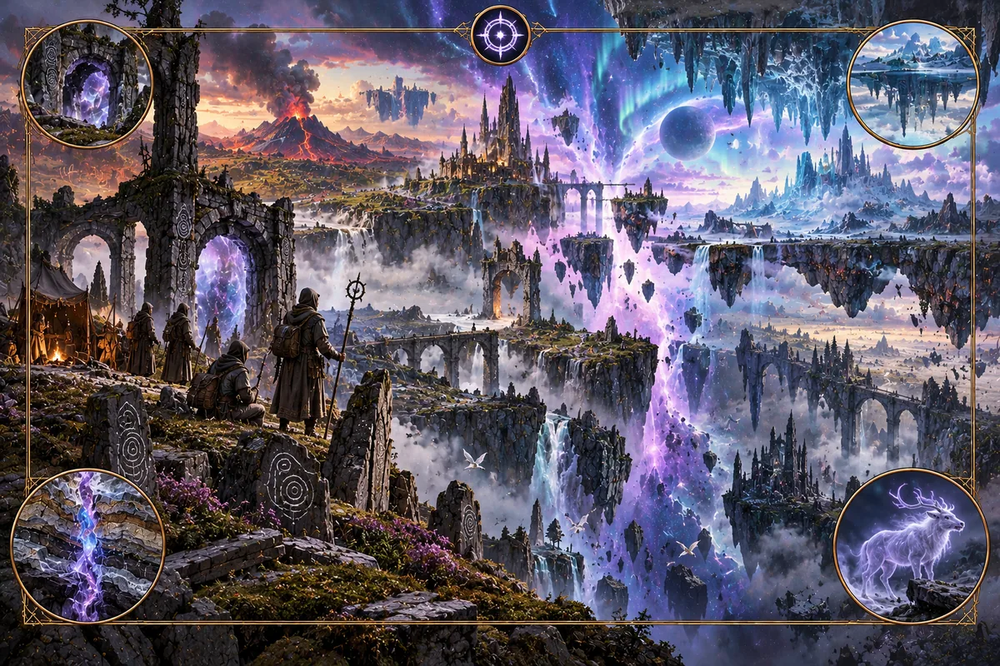

# Veil

_A door needs a house, and a house needs a keeper._

**Physical character.** Veil forms where other systems interfere strongly enough to tear space: Fire
against Aurora, Pressure against an Aurora coast, or Greenwood against Salt. Tears occur where the
fields change sharply across their shared boundary. A small or shifting tear creates a wild zone,
where terrain and vegetation change between surveys without an ordinary geographic cause. A large,
stable tear pairs with another stable tear elsewhere. The pair forms a door connecting two places
that are otherwise far apart.

**Where it is found.** Veil occurs only at strong boundaries between other systems. A world with
just one other magic system has no Veil. More systems create more opportunities for tears,
especially where their boundaries are under severe strain.

**Effects on the world.** Wild zones make maps unreliable. A hill shifts, a stream changes course
without flooding, or a forest edge moves between surveys. The atlas marks these regions and shows
features in their alternate positions. A door leaves only a small local trace: a ring of unusual
vegetation and a cold pool. Its effect on travel is much larger. A short crossing can replace a
journey across a continent, making an inland city with a door a trade hub much like a port.

**Practice.** Practitioners stabilise a tear by housing it. They build around it and place a post at
the centre: a trunk, standing stone or living tree that serves as the crossing's axis. Door-keepers
maintain the house and post, and follow a prescribed sequence when opening the crossing. They begin
by greeting the gatekeeper before making any other request. Forcing a crossing without a house
worsens the wild zone and is considered lethal.

Crossing has a cost. The crossing inhabits the traveller for a time, leaving them partly connected
to the place they left and unsure where they are. Repeated crossings deepen this disorientation. The
oldest keepers speak of their own country as one of several places they might be standing in.

**Lore.** Veil traditions describe a crossing as a presence that descends along an axis between
places. The post gives it a path into the house. Without one, they say, it enters the ground instead
and moves the landscape as a spirit might move a body. Hills and streams shift until the presence
leaves, then settle in altered positions. Keepers regard such places with pity as well as fear. A
wild zone is a door no one built a house for.

A door-house gives that presence both a path and rules: who must be greeted first, who opens the
crossing, and who may host it for how long. Keepers teach that neglecting the first greeting opens
the door onto the wrong place. A fortress at a door therefore guards the opening ritual as carefully
as the passage itself. The far side is spoken of as a neighbouring house, with its own post and
customs. A door-empire depends on knowing the customs of many houses.

> The inn beside the door had two front steps. Snow lay on one. Red dust covered the other. The
> keeper swept both into the same pan.
>
> "You're a long way from home," I said.
>
> "Which one?"

_From a traveller's account of the door-roads._

**Interference.** Veil depends on interference between other systems. Aurora-crystals close doors,
Fire releases rupture them, and Hallowed wards seal them. A practitioner's stored Pressure charge
cannot pass through a door. New boundaries between systems can create more Veil where the
interference is strong enough.

---

[Magic lore bible](../magic.md) · [Fire](fire.md) · [Aurora](aurora.md) · [Pressure](pressure.md) ·
[Greenwood](greenwood.md) · [Salt](salt.md) · [Hallowed](hallowed.md)
